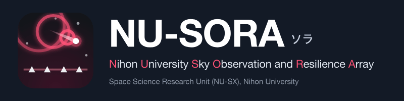

<p align="center"></p>

# nu-sx.github.io

日本大学 理工学部（理工学研究所）**宇宙科学研究ユニット NU-SX** が公開する Web デモのサイト。

| 公開物 | パス | 内容 |
|---|---|---|
| **NU-SORA 観測ポータル デモ版** | [`nu-sora/`](nu-sora/) | 日本大学 全学屋上観測網「ソラ」（Nihon University Sky Observation and Resilience Array）の観測ポータル。全国 14 局の火球・スペースデブリ再突入・インフラサウンド・線状降水帯・気象／熱中症・夜空の明るさを統合表示する |

> **表示される観測値・イベントはすべて模擬データであり、実際の観測結果ではありません。**
> 観測局の配置・機材構成・解析手法は検討中の計画に基づきます。

表紙には、デモ本体のモジュールを遅延読み込みして **観測局と機材構成のダイジェスト**（全天カメラ・
インフラサウンド・電波流星 FFT・複合気象センサー・夜空輝度計・2 周波 GNSS の 6 系統）を表示する。
読み込みに失敗しても本文は壊れない。

このリポジトリには公開に必要なファイルだけを置いている。開発用のソースと履歴は非公開のリポジトリで管理する。

## 公開URL

Organization `nu-sx` 配下の `<org>.github.io` なので、**組織サイト**としてルート URL で公開される。

- サイト表紙 … `https://nu-sx.github.io/`
- NU-SORA デモ … `https://nu-sx.github.io/nu-sora/`

## デプロイ

GitHub Pages の **Deploy from a branch** で公開する。ビルド工程を持たない素の静的サイトなので、
Actions を経由せず `main` ブランチの内容をそのまま配信するのが最も確実で、以後は push するだけで反映される。

初回のみ、リポジトリの設定を 1 か所変更する（`https://github.com/nu-sx/nu-sx.github.io/settings/pages`）。

| 項目 | 設定値 |
|---|---|
| Build and deployment → **Source** | **Deploy from a branch** |
| **Branch** | `main` / `/ (root)` |

設定後、1〜2 分で公開される。`.nojekyll` を置いてあるので Jekyll による変換は行われない。

> Actions 経由（`actions/deploy-pages`）でも公開できるが、`GITHUB_TOKEN` には Pages サイトを
> **新規作成する**権限がないため、`actions/configure-pages` の `enablement: true` は
> `Resource not accessible by integration` で失敗する。Actions 方式を使う場合は、
> 先に Settings → Pages → Source を **GitHub Actions** に設定してから実行すること。

## 検索エンジンへの登録について

このサイトは関係者への共有を目的としたもので、関係者以外への一般公開はしていない。
そのため各ページには `<meta name="robots" content="noindex">`（`abelab/` は `noindex,nofollow`）を入れてあり、
検索エンジンには登録されない。

## ローカルでの確認

```bash
python3 -m http.server 8000
# → http://127.0.0.1:8000/          サイト表紙
# → http://127.0.0.1:8000/nu-sora/  NU-SORA デモ
```

`nu-sora/index.html` はビルド不要で、ファイルを直接開いても動作する。

## 出典・参考文献

各文献のデモ内での対応は、デモの「このデモについて」画面および [`nu-sora/README.md`](nu-sora/README.md) を参照。
